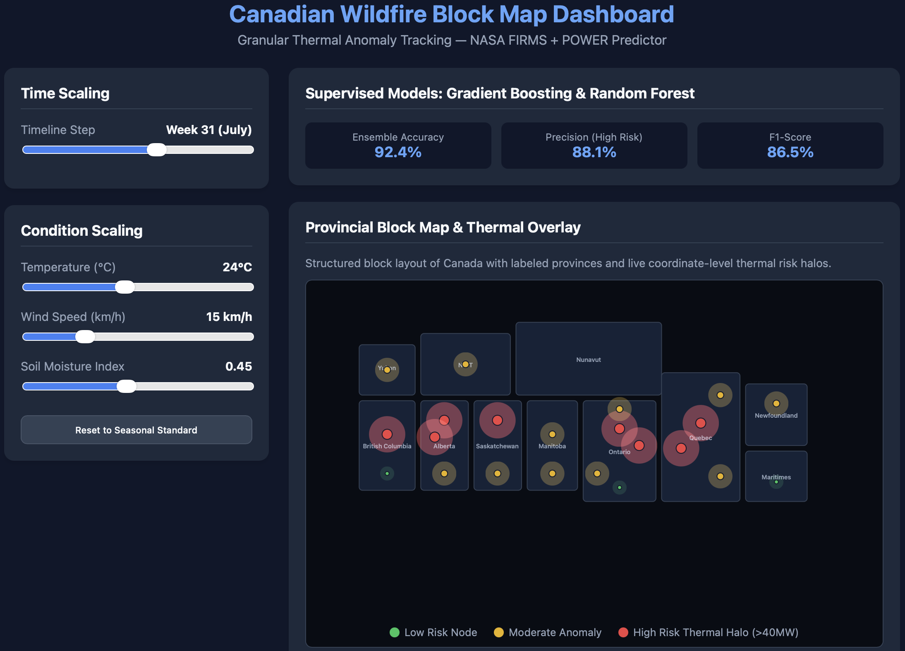

# Wildfire project outline
Details on what exactly we'd need to do from beginning to end.

## Which model to use?
Instead of picking just one, a strong machine learning project often approaches the same core problem from multiple angles:
1. Classification (The "Early Warning" System):
  - Target: Binary outcome (1 = High-intensity fire day/risk, 0 = Low/No major fire).
  - Why use it: It's extremely practical. Emergency services care most about whether a region is about to cross a dangerous threshold. It lets you use precision, recall, and ROC-AUC curves (Chapter 3) to evaluate how well your model catches true threats without sounding false alarms.
2. Regression (The "Magnitude" System):
  - Target: Continuous value (e.g., predicted maximum Fire Radiative Power [FRP] or total area burned).
  - Why use it: If you want to know how severe a fire will be once it starts, regression models (like Random Forest Regressor or Gradient Boosting) give you a continuous scale.
3. Unsupervised Learning / Clustering (Chapter 9) — The "Something Else":
  - How to use it: Before training your predictive models, run K-Means or DBSCAN clustering on your geographic/weather data to automatically group Canadian regions into distinct "climate-risk zones" based on temperature, humidity, and historical fire frequency. You can then feed these cluster IDs as a powerful categorical feature into your classification/regression models

## Timeline of work

#### Phase 1: Scoping & Data Acquisition (Week 1)

* **The Goal:** Narrow the global scope strictly to Canada and download a clean timeframe (e.g., 2012–2025).
* **How to approach it:**
1. Go to **NASA FIRMS** and use their spatial bounding box or archive download tool filtered for Canada (latitudes $\sim 41^\circ$ to $84^\circ\text{N}$, longitudes $\sim 52^\circ$ to $141^\circ\text{W}$) to pull active fire/hotspot CSV data.
2. Pull matching weather variables (temperature, relative humidity, precipitation, wind speed) from **NASA POWER** for Canadian coordinate grids over that same date range.

#### Phase 2: Data Preparation & Feature Engineering (Chapters 2 & 4) (Week 2)

* **Spatial-Temporal Aggregation:** Raw satellite points are just individual thermal hits. To make it machine-learning friendly, you aggregate the data into **spatial grid cells** (e.g., breaking Canada down into a grid or looking at it province-by-province/eco-zone) on a **daily or weekly basis**.
* **Target Variables:**
* *For Regression:* Predict the maximum **Fire Radiative Power (FRP)** for a given region/day.
* *For Classification:* Predict a binary outcome: *High-intensity wildfire day (1)* vs. *Normal/No major fire day (0)*.

* **Handling Features:** Merge NASA POWER weather metrics (temperature, wind speed, drought/precipitation lags) with your FIRMS grid. Scale your features using standard scikit-learn scalers (Chapter 4).

#### Phase 3: Model Training & Comparison (Chapters 3, 6, & 7) (Week 3)

Build and evaluate at least two or three model types:

1. **Baseline Model:** Logistic Regression (for classification) or Linear/Ridge Regression (Chapter 4).
2. **Tree-Based / Ensemble Models (Chapters 6 & 7):** Random Forest Classifier/Regressor and Gradient Boosting. These typically crush tabular geospatial data because they can handle non-linear interactions (e.g., high wind speed + high temperature + low soil moisture = exponential fire risk).
3. **Evaluation:** Because wildfire days are rarer than non-wildfire days, look at **Precision, Recall, and F1-score** alongside ROC-AUC (Chapter 3) rather than just raw accuracy.

#### Phase 4: Visualizer App Development (Week 4)

* Build a clean web application (using HTML/CSS/JS or a lightweight React framework) to showcase your results.
* **What the visualizer should show:** An interactive map or dashboard placeholder where users can select a Canadian region, view historical fire intensity trends, and see model predictions (e.g., "High Risk vs. Low Risk" wildfire forecast based on simulated weather sliders).

## Division of Work

To ensure everyone does a fair share of hands-on coding and machine learning work without stepping on each other's toes, you can divide the project pipeline into **four distinct technical pillars** mapped directly to your textbook chapters (Ch 2, 4, 6, 7, 9):

#### Member 1: Data Engineering & Pipeline Lead (Chapters 2 & 4)

* **Responsibility:** Owning the data ingestion and cleaning pipeline.
* **Tasks:**
* Pulling and filtering the NASA FIRMS (fire data) and NASA POWER (weather data) specifically for Canada.
* Writing the script to aggregate point-based satellite data into a clean spatial-temporal grid (e.g., daily grid cells by region).
* Handling missing values, data type conversions, and automated merging of weather and fire datasets.

#### Member 2: Feature Engineering & Exploratory Data Analysis (EDA) Lead (Chapter 4)

* **Responsibility:** Transforming raw data into predictive features.
* **Tasks:**
* Creating lag features (e.g., "what was the average temperature and precipitation over the *last 7 days*?").
* Performing feature scaling, handling skewed distributions (e.g., log transformations on FRP values), and running feature selection techniques to drop noisy variables.
* Creating correlation matrices and visual plots for the presentation.

#### Member 3: Supervised Modeling Lead — Classification & Ensembles (Chapters 3, 6, & 7)

* **Responsibility:** Building the core classification models to predict high-risk wildfire days.
* **Tasks:**
* Setting up the training/test splits and baseline models (Logistic Regression).
* Training advanced ensemble models (Random Forest Classifier and Gradient Boosting from Chapters 6 & 7).
* Evaluating models using **Precision, Recall, F1-Score, and ROC-AUC** (Chapter 3) to handle class imbalance (since severe fire days are rarer than normal days).

#### Member 4: Unsupervised Clustering & App Visualizer Lead (Chapter 9 & Web App)

* **Responsibility:** Adding advanced unsupervised learning and building the user-facing web app.
* **Tasks:**
* Implementing **K-Means or DBSCAN clustering (Chapter 9)** to group Canadian regions into behavioral climate-risk clusters and testing if adding cluster labels improves the supervised model's accuracy.
* Building the simple HTML/JS or React app visualizer that displays the model's predictions, risk maps, or interactive weather sliders.

## Workflow Schedule

Because machine learning projects follow a modular pipeline, your team does not need to wait in a single-file line. While **Phase 1 (Data Engineering)** has to happen first because everyone needs the clean dataset, once that foundational data is ready, **Members 2, 3, and 4 can work completely in parallel.**

#### Week 1: Foundational Setup (All Hands or Member 1 Focus)

* **What happens:** Everyone agrees on the final dataset bounds (e.g., NASA FIRMS + POWER for Canada, 2012–2025).
* **The bottleneck:** Member 1 takes the lead on pulling the raw data, merging weather and fire points, and producing a clean master CSV file.
* *Note:* While Member 1 is doing this, Members 2, 3, and 4 can sketch out their code architecture, write skeleton functions, or look over textbook chapters (Ch 3, 4, 6, 7, 9) for the algorithms they'll use.

#### Weeks 2 & 3: Fully Concurrent Execution (The Core Work)

Once Member 1 drops the clean master CSV into a shared GitHub repository or folder, **all four members can work simultaneously in separate branches/scripts:**

* **Member 2 (Feature Engineering):** Writes feature-extraction scripts (creating 7-day weather lags, scaling, handling missing values) and outputs a finalized `features.csv`.
* **Member 3 (Supervised Models):** Can use a temporary mock/subset dataset right away to write the training and evaluation loops for Logistic Regression, Random Forests, and Gradient Boosting, swapping in the final `features.csv` once Member 2 finishes.
* **Member 4 (Clustering & Visualizer):** Runs K-Means/DBSCAN clustering on the data to generate cluster tags, *and simultaneously* starts mocking up the HTML/CSS/JS or React visualizer layout.

#### Week 4: Integration & Polish

* **What happens:** Member 3's best-performing model (e.g., Gradient Boosting) and Member 4's clustering results are plugged into the visualizer app. The team runs final tests, prepares the presentation slides, and reviews the learning outcomes together.

---

### Pro-Tip for Team Success

To make concurrent work painless, use a shared **GitHub repository** or Google Colab folder divided into modular Python scripts (e.g., `data_loader.py`, `feature_engineering.py`, `models.py`), or have each person work in their own Jupyter Notebook named after their role.

## Report Visualizer

See `mock-visualizer.html` for a brief demo. 

Additional things to plug in for novelty points include:
  - Feature Importance Bar Chart: Add a simple horizontal bar chart showing what features drove the prediction most (e.g., 7-day rolling temperature vs. soil moisture vs. wind speed), tying directly into Chapter 4 & 7 feature selection discussions.
  - Model Toggle Switch: Let the user toggle between Logistic Regression and Gradient Boosting on the UI to see how the "predictions" change or become more nuanced.
  - Confusion Matrix Preview: Add a small visual 2x2 grid representing True Positives, False Positives, etc., to visually explain your Precision/Recall tradeoffs to a non-technical audience.

